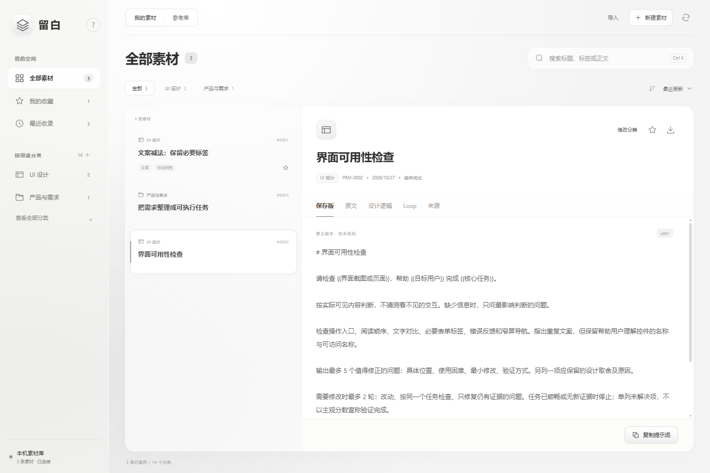

# 留白 · 提示词素材库

把散落在聊天和文件里的提示词，整理成自己的素材库。保留原文、分类、来源和独立版本，随时搜索、复制、复用。简约白、中性灰和磨砂玻璃界面。

**Local-first prompt library · Python standard library · REST API + MCP · MIT**

[下载最新版](https://github.com/Shanvision-star/liubai-prompt-library/releases/latest) · [使用指南](docs/USER-GUIDE.md) · [连接 Codex](docs/INTEGRATIONS.md) · [反馈问题](https://github.com/Shanvision-star/liubai-prompt-library/issues)



## 开始使用

需要 **Python 3.11+**，无需 Node、数据库或模型 API 密钥。下载 ZIP 并解压，或者用 Git：

```sh
git clone https://github.com/Shanvision-star/liubai-prompt-library.git
cd liubai-prompt-library
python -X utf8 start.py
```

启动后自动打开浏览器。macOS / Linux 若没有 `python` 命令，使用 `python3 -X utf8 start.py`。首次启动创建空库和 13 个分类；点击“保存第一条素材”，或导入 `.md` / `.txt` 文件，确认后保存。可以先试试[示例提示词](examples/)。

Windows 也可双击 `Open-Desktop.cmd`，优先使用 Edge / Chrome 独立窗口，无可用应用窗口浏览器时使用默认浏览器。这个入口的服务在后台运行；完全停止可执行：

```powershell
powershell.exe -NoProfile -ExecutionPolicy Bypass -File .\desktop\Stop-Desktop.ps1
```

`start.py` 在当前终端运行服务，按 `Ctrl+C` 停止。需要把代码与资料分开放置时：

```sh
python -X utf8 start.py --data-root /absolute/path/to/my-library --port 8767
```

路径有空格时用引号括起来。“使用与数据”显示当前实际位置。服务仅监听本机回环地址；项目提供源码发行包，需要本机 Python，不是免安装的原生程序。

## 保存与分类

1. 点击“新建素材”，粘贴原文或导入 UTF-8 `.md` / `.txt` 文件；填写标题和分类，标签、优化版可选。
2. 选择已有分类，或填写一个新分类名称；也可单独新增分类。
3. 保存后立即检索、收藏、复制或导出；已有素材可在界面修改分类，API / MCP 还可更新标签。

原文逐字保存并计算SHA-256，相同原文重复提交会返回已有条目。修改分类只改元数据，不改原文和版本。没有填写优化版时明确显示“保存版／尚未优化”；填写的优化版也保持效果待实测，不会假装已经经过模型或用户评估。

默认13类：开发与编程、UI设计、大模型设计、LangChain设计、审美Taste、产品与需求、商务与销售、内容与写作、视觉与视频、学习与研究、办公与效率、通用与角色、待分类。自定义分类与默认分类使用相同检索和保存流程。

窄屏的“浏览”菜单保留全部、收藏、最近与分类入口。`Ctrl+K` / `⌘K` 聚焦搜索。关闭新建窗口会保留本页草稿；刷新或关闭页面前提示未保存内容，草稿不写入浏览器持久存储。

## Codex与其他工具接入

项目同时提供：

- **本地MCP**：Codex按指令调用工具保存提示词、查询分类、检索、读取和修改分类。stdio连接，不需要独立模型API，也不会监听或读取Codex聊天数据库。
- **REST API**：`POST /api/prompts`保存，`POST /api/categories`新增分类，`POST /api/entries/{id}/metadata`改分类等元数据。

本机客户端通过Bearer令牌写入；令牌由HTTP服务保存在当前运行目录的`api-token`文件中，不返回网页、不写入Git。浏览器操作使用同源校验。MCP直接调用同一存储层，不依赖HTTP服务或Bearer令牌。

[接入步骤、工具参数与请求示例](docs/INTEGRATIONS.md) · [OpenAPI文档](docs/openapi.json)

在“使用与数据”中复制当前安装和资料目录对应的 MCP 配置，再按接入说明添加到客户端。不同入口需使用同一个资料目录，才能看到同一批素材。

注册MCP配置与当前会话已加载工具是两件事，连接状态需在客户端查看。保存不等于自动优化；如需优化，由当前授权的Codex或其他分析者生成内容后明确保存。

## 参考库

支持GitHub搜索与文件链接导入、收藏、关注、原文优先阅读、拆解卡、版本差异和采用预览。上游变化进入新的快照与待分析队列，个人版本不会被静默覆盖。

公开发行版从空库开始，不捆绑开发者个人素材或第三方提示词全文。导入材料时核对许可与具体使用条件，许可未知的候选只保留链接和元数据。分析者可记录结构、关键句作用、通用模板、改写示例、反例与有停止条件的Loop。

增量检查与调度支持见 [参考库维护说明](docs/REFERENCE-UPDATES.md)。**独立安装默认没有已注册的调度器**；登记调度编号不等于创建定时任务。实际分析能力不可用时保持“待分析”，不使用固定文案模拟AI分析。

## 文件与隐私

程序与资料分开：默认分类模板在`defaults/`，运行后生成的资料保存在所选数据目录。

```text
entries/PRM-xxxx/        原文、保存或优化版本、元数据
references/             来源快照、拆解、采用关系与运行记录
index.json / INDEX.md   素材索引
taxonomy.json           默认与自定义分类
desktop/.runtime/       本机令牌、收藏、日志和浏览器状态
```

以上个人数据和运行文件默认被`.gitignore`排除。代码不自动上传素材、不配置云同步；GitHub搜索和来源检查会请求GitHub，日常本地浏览与保存不调用模型。若将数据目录另放在其他Git仓库，请自行保持相应忽略规则。

## 备份与升级

升级前可在“使用与数据”点击“导出备份”。ZIP 包含个人原文与版本、分类、参考快照与分析、收藏和校验清单；不含令牌、浏览器档案、执行日志或机器调度注册。备份仍含私人素材，请妥善保管。

恢复时解压到**新的空目录**，用 `--data-root` 指向它，检查素材后再继续使用，不要覆盖现有库。网页备份上限 256 MiB / 10000 文件。升级程序时先备份并停止旧服务，将新程序解压到另一目录，继续指向原来的资料目录。详见[备份与升级指南](docs/USER-GUIDE.md)。

## 开发

```sh
python -m pip install -r requirements-dev.txt
python -X utf8 -m pytest desktop/tests -q
```

测试使用临时目录与模拟网络响应，不消耗模型API额度。前端为HTML/CSS/JavaScript，无构建步骤。详见 [开发说明](docs/DEVELOPMENT.md)。

## 许可证

程序使用 [MIT License](LICENSE)。用户自行收录的提示词和参考材料保留各自来源与许可，不因放入本库而改为MIT。
